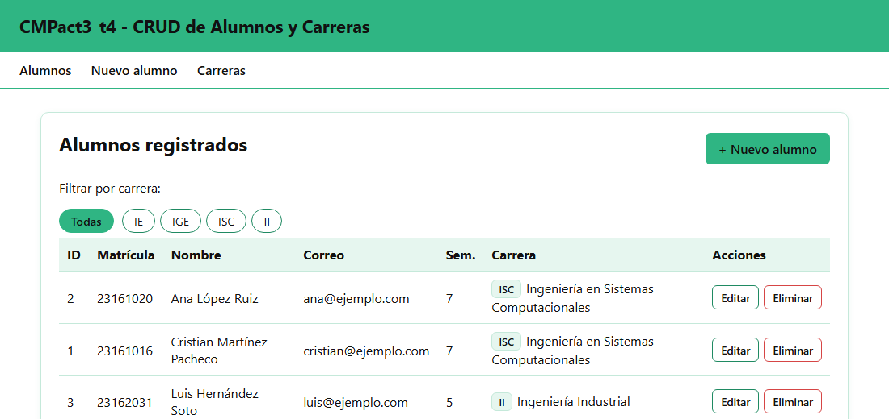
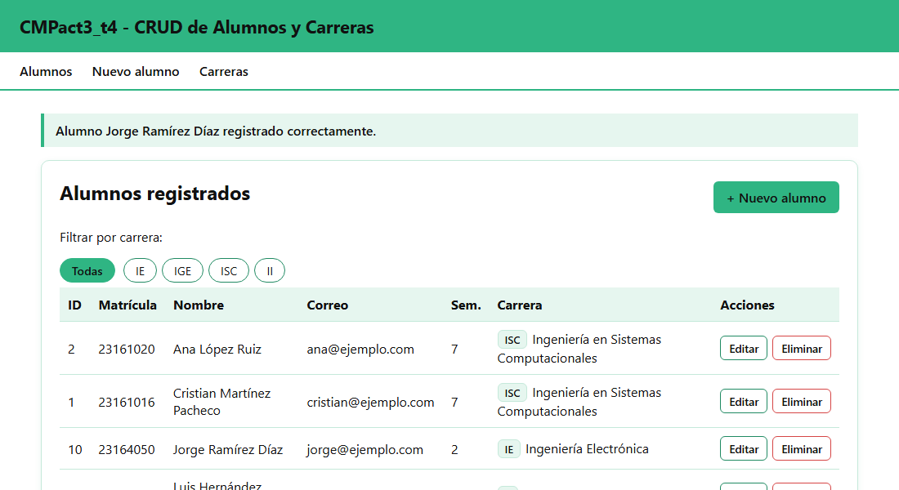
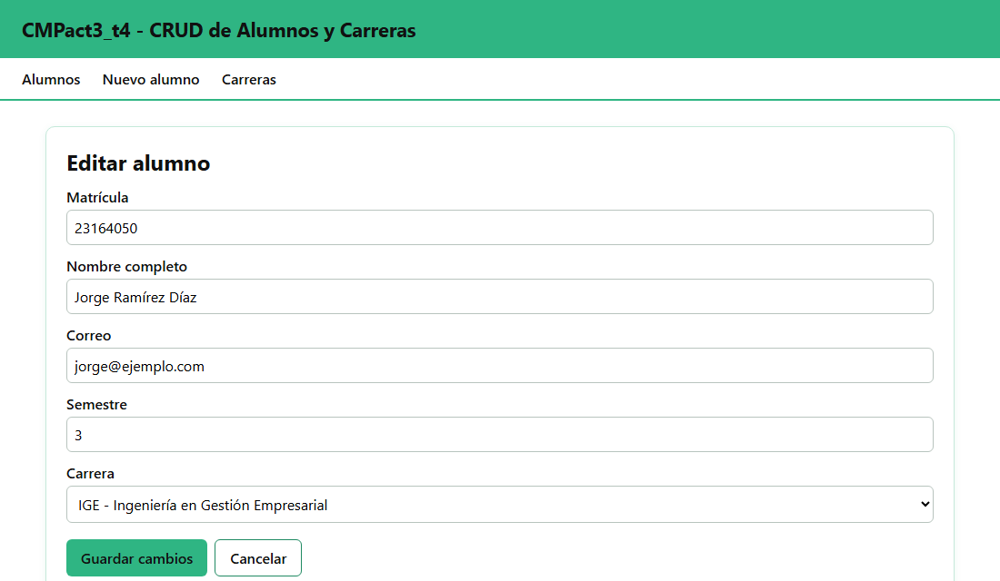
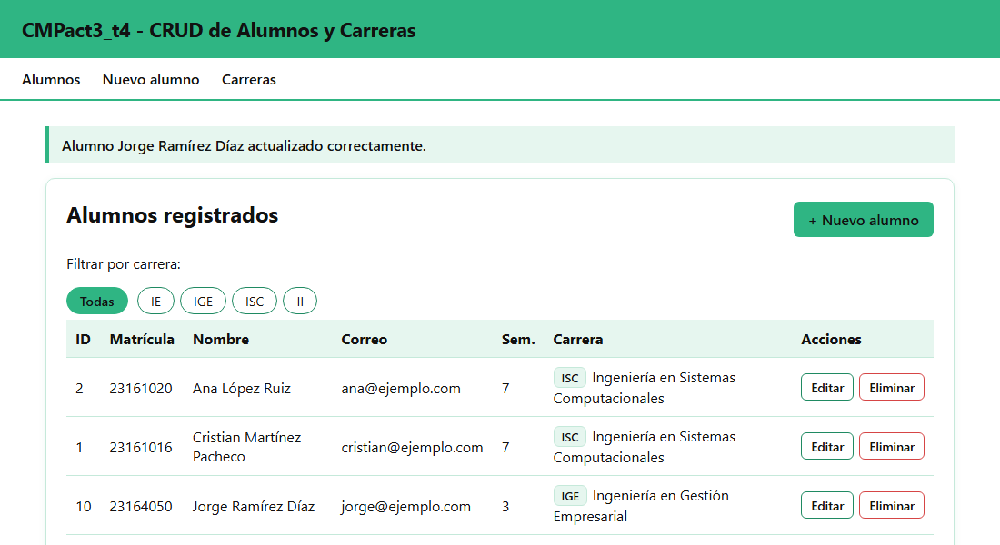
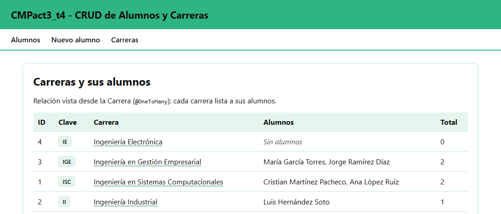
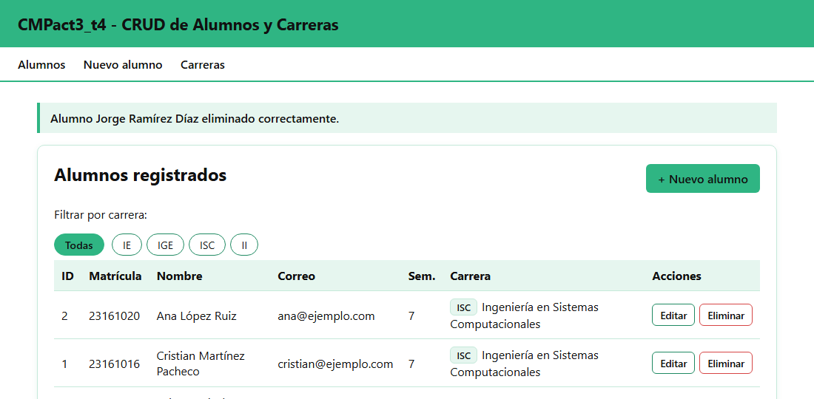

# CMPact3_t4

Actividad 3, Tema 4: CRUD en Spring Boot con MySQL y una relación entre entidades (JPA), probado con vistas Thymeleaf dentro del mismo proyecto y con Postman.

**Alumno:** Cristian Martínez Pacheco · Matrícula 23161016 · Grupo 7SC

## Tema: Alumnos y Carreras

| Entidad | Tabla | Relación |
|---|---|---|
| `Alumno` (entidad principal del CRUD) | `alumnos` | `@ManyToOne`: muchos alumnos pertenecen a una carrera |
| `Carrera` | `carreras` | `@OneToMany(mappedBy = "carrera")`: una carrera tiene muchos alumnos |

La llave foránea es la columna `alumnos.carrera_id`, que apunta a `carreras.id`:

```java
// Alumno.java (lado dueño de la relación)
@ManyToOne(optional = false)
@JoinColumn(name = "carrera_id", nullable = false,
        foreignKey = @ForeignKey(name = "fk_alumno_carrera"))
private Carrera carrera;

// Carrera.java (lado inverso)
@OneToMany(mappedBy = "carrera")
private List<Alumno> alumnos = new ArrayList<>();
```

## Tecnologías
- Spring Boot 4.1.2 (Java 21)
- Spring Web, Spring Data JPA, MySQL Driver, Thymeleaf
- MySQL 9.5 en local · MySQL en el VPS (Ubuntu 24.04)

## Estructura por capas

```
src/main/java/com/example/cmpact3_t4/
├── entity/       Alumno, Carrera                 → tablas y relación JPA
├── repository/   AlumnoRepository, CarreraRepository (extienden JpaRepository)
├── service/      AlumnoService, CarreraService   → lógica de negocio y validaciones
├── controller/   AlumnoViewController, CarreraViewController (vistas Thymeleaf)
│                 AlumnoRestController, CarreraRestController (JSON)
├── dto/          AlumnoRequest                   → datos del formulario y de Postman
└── config/       DatosIniciales                  → carga carreras y alumnos de ejemplo
```

Los controladores no tienen lógica: solo llaman al `Service`, y el `Service` usa los `Repository` para hablar con la base de datos.

## Endpoints

### Vistas (Thymeleaf)
| Operación | Método | Ruta |
|---|---|---|
| READ (lista, filtro por carrera) | GET | `/alumnos`, `/alumnos?carreraId=1` |
| CREATE | GET / POST | `/alumnos/nuevo` → `POST /alumnos` |
| UPDATE | GET / POST | `/alumnos/{id}/editar` → `POST /alumnos/{id}` |
| DELETE | POST | `/alumnos/{id}/eliminar` |
| Relación desde la carrera | GET | `/carreras` |

### API REST (JSON)
| Operación | Método | Ruta | Respuesta |
|---|---|---|---|
| READ todos | GET | `/api/alumnos` | 200 |
| READ uno | GET | `/api/alumnos/{id}` | 200 / 404 |
| CREATE | POST | `/api/alumnos` | 201 |
| UPDATE | PUT | `/api/alumnos/{id}` | 200 |
| DELETE | DELETE | `/api/alumnos/{id}` | 204 |
| Carreras | GET | `/api/carreras` | 200 |
| Alumnos de una carrera | GET | `/api/carreras/{id}/alumnos` | 200 |

Cuerpo para crear o actualizar:
```json
{
  "matricula": "23169999",
  "nombre": "Alumno de Prueba Postman",
  "email": "prueba@ejemplo.com",
  "semestre": 4,
  "carreraId": 1
}
```
La respuesta incluye la carrera completa, no solo su id:
```json
{
  "id": 6,
  "matricula": "23169999",
  "nombre": "Alumno de Prueba Postman",
  "email": "prueba@ejemplo.com",
  "semestre": 4,
  "carrera": { "id": 1, "clave": "ISC", "nombre": "Ingeniería en Sistemas Computacionales" }
}
```

**Colección de Postman:** [`postman/CMPact3_t4.postman_collection.json`](postman/CMPact3_t4.postman_collection.json). Impórtala en Postman: trae el CRUD completo en orden (crear, leer, actualizar, eliminar y verificar), con pruebas automáticas. La variable `baseUrl` apunta al VPS; cámbiala a `http://localhost:8083` para probar en local.

## Capturas de pantalla

### READ: lista de alumnos con su carrera
Cada alumno muestra la clave y el **nombre** de su carrera (relación `@ManyToOne`).



### CREATE: nuevo alumno




### UPDATE: editar alumno (cambio de semestre y de carrera)




### Relación vista desde la carrera (`@OneToMany`)


### DELETE: eliminar alumno


## Base de datos (MySQL)

Hibernate crea las tablas a partir de las entidades (`spring.jpa.hibernate.ddl-auto=update`). Estructura real en MySQL:

```
DESCRIBE carreras;
+--------+--------------+------+-----+---------+----------------+
| Field  | Type         | Null | Key | Default | Extra          |
+--------+--------------+------+-----+---------+----------------+
| id     | bigint       | NO   | PRI | NULL    | auto_increment |
| clave  | varchar(10)  | NO   | UNI | NULL    |                |
| nombre | varchar(100) | NO   |     | NULL    |                |
+--------+--------------+------+-----+---------+----------------+

DESCRIBE alumnos;
+------------+--------------+------+-----+---------+----------------+
| Field      | Type         | Null | Key | Default | Extra          |
+------------+--------------+------+-----+---------+----------------+
| id         | bigint       | NO   | PRI | NULL    | auto_increment |
| email      | varchar(100) | YES  |     | NULL    |                |
| matricula  | varchar(20)  | NO   | UNI | NULL    |                |
| nombre     | varchar(100) | NO   |     | NULL    |                |
| semestre   | int          | YES  |     | NULL    |                |
| carrera_id | bigint       | NO   | MUL | NULL    |                |
+------------+--------------+------+-----+---------+----------------+

Llave foránea:
+-------------------+------------+-------------+-----------------------+------------------------+
| CONSTRAINT_NAME   | TABLE_NAME | COLUMN_NAME | REFERENCED_TABLE_NAME | REFERENCED_COLUMN_NAME |
+-------------------+------------+-------------+-----------------------+------------------------+
| fk_alumno_carrera | alumnos    | carrera_id  | carreras              | id                     |
+-------------------+------------+-------------+-----------------------+------------------------+

SELECT a.id, a.matricula, a.nombre, a.carrera_id, c.clave, c.nombre AS carrera
FROM alumnos a JOIN carreras c ON c.id = a.carrera_id;
+----+-----------+----------------------------+------------+-------+-----------------------------------------+
| id | matricula | nombre                     | carrera_id | clave | carrera                                 |
+----+-----------+----------------------------+------------+-------+-----------------------------------------+
|  1 | 23161016  | Cristian Martínez Pacheco  |          1 | ISC   | Ingeniería en Sistemas Computacionales  |
|  2 | 23161020  | Ana López Ruiz             |          1 | ISC   | Ingeniería en Sistemas Computacionales  |
|  3 | 23162031  | Luis Hernández Soto        |          2 | II    | Ingeniería Industrial                   |
|  4 | 23163045  | María García Torres        |          3 | IGE   | Ingeniería en Gestión Empresarial       |
+----+-----------+----------------------------+------------+-------+-----------------------------------------+
```

## Ejecutar en local
1. Crea la base de datos y el usuario de prueba (como root):
   ```bash
   mysql -u root -p < db/crear_bd_local.sql
   ```
2. Ejecuta el proyecto:
   ```bash
   ./mvnw spring-boot:run
   ```
3. Abre http://localhost:8083/alumnos

## Credenciales
`application.properties` **no tiene contraseñas reales**. La conexión se toma de variables de entorno, y solo usa valores de prueba en local si no existen:

```properties
spring.datasource.url=${DB_URL:jdbc:mysql://localhost:3306/cmpact3_t4?...}
spring.datasource.username=${DB_USER:cmpact3}
spring.datasource.password=${DB_PASSWORD:cmpact3_local}
```

En el VPS, `DB_URL`, `DB_USER` y `DB_PASSWORD` se definen en un archivo `act3.env` que solo existe en el servidor.

## Proyecto en el VPS
- http://68.155.155.10:8083/alumnos
- https://cristian-mp.mexicocentral.cloudapp.azure.com/act3-t4/alumnos

Las actividades anteriores siguen corriendo en sus puertos: Actividad 1 en el **8081** y Actividad 2 en el **8082**.
